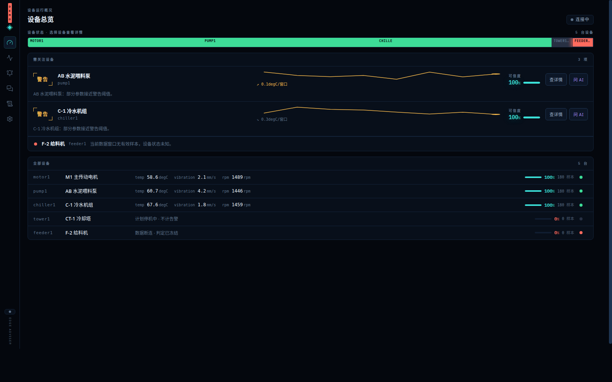
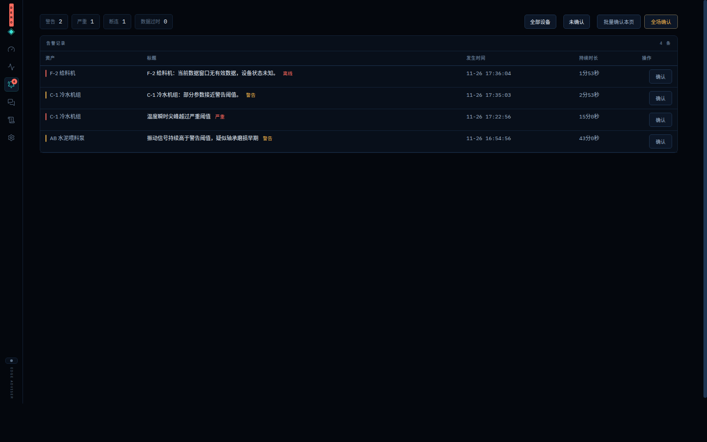
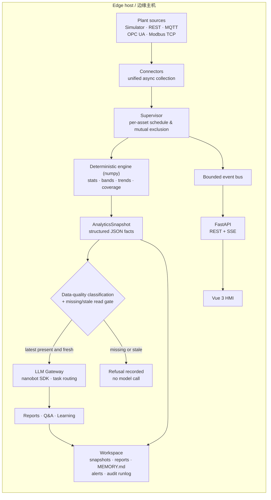

<div align="center">


# Oxpecker

**An open-source MVP: the shopfloor edge agent that watches your machines and explains what it sees.**

**Oxpecker（啄牛鸟）：一个开源 MVP —— 停在车间边缘、日夜守望设备、诚实报告的 Agent。**

[中文说明](docs/README.zh-CN.md) · [Architecture](#-architecture) · [Quick Start](#-quick-start) · [Screenshots](#-system-screenshots) · [CLI](#-cli-reference) · [Deployment](#-deployment) · [Design notes](DESIGN.md)

</div>

> [!IMPORTANT]
> Oxpecker is an **advisory and observability system, not a safety controller**. Keep PLC interlocks, protective trips, and site safety procedures independent, and validate outputs with qualified personnel.
>
> Oxpecker 用于辅助分析与观测，**不是安全控制器**。请由专业人员验证结果，并保持 PLC 联锁、保护跳闸和现场安全规程独立有效。

## Why Oxpecker

Industrial telemetry fails in a specific way: the data is incomplete, stale, or
intermittent, and an LLM asked "how is this machine doing?" will happily invent
a confident answer anyway. Oxpecker is designed to limit that risk by keeping
measurements deterministic, carrying data-quality metadata, and making missing
or stale reads explicit.

**The oxpecker bird rides the rhino and warns it.** It doesn't steer the
rhino — it watches, and when danger approaches, it is the first to call out.
That is the contract this agent keeps with your equipment: observed facts,
explicit data-quality signals, and alarms that operators can inspect.

### What the agent actually does

Oxpecker runs a closed loop on an edge host, per monitored asset:

```
connect → collect → analyze (deterministic) → gate (trust decision) → interpret (LLM) → report / alert / learn
```

1. **Connect** — pull a collection window from the plant network through one of
   five built-in connectors: `simulator`, `REST`, `MQTT`, `OPC UA`, `Modbus TCP`.
2. **Analyze, deterministically** — a numpy engine turns the raw window into an
   `AnalyticsSnapshot`: statistics, band-exceedance runs, trends, coverage,
   sample counts, data freshness. **Every source metric and data-scope value
   in the snapshot is computed by this code, never generated by a model.**
   The narrative is model-generated and must still be checked against the
   snapshot and qualified personnel's judgment.
3. **Classify data quality and gate reads** — deterministic analysis records
   sample sufficiency, coverage, freshness, and consecutive-empty state in each
   snapshot. Before Q&A or report interpretation, a read gate refuses when the
   latest snapshot is missing or stale. A fresh snapshot marked partial or
   insufficient is not silently promoted to healthy: its trust/status metadata
   accompanies interpretation. The learning path applies its own configurable
   soft/strict gate before updating `MEMORY.md`.
4. **Interpret** — only for gate-passed snapshots, an LLM explains the facts:
   routine status lines, scheduled deep reports, and engineering Q&A. The
   snapshot, asset profile, and retrieved knowledge are injected as context —
   never the raw time series.
5. **Learn** — a scheduled daily pass distills "how this machine actually
   behaves" (observed limits, fault precursors, maintenance outcomes) into a
   per-asset `MEMORY.md` knowledge base, versioned with git and informed by
   operator feedback.
6. **Serve** — FastAPI REST + SSE with a browser HMI (overview, alerts, audit
   log, per-asset detail, configuration editor), plus a CLI for scripted
   operation and a demo mode that runs fully offline.

### Honest refusal is the feature

Most LLM-industrial demos answer every question. Oxpecker is built around the
opposite behavior:

| Data condition | Behavior |
|---|---|
| Fresh snapshot with sufficient samples and coverage | Deterministic analysis + interpretation with the snapshot's data-scope metadata |
| Fresh snapshot with low coverage or insufficient samples | Quality status and coverage remain visible to the model; the learning gate applies its configured soft/strict policy |
| No snapshot or stale latest snapshot | Q&A and deep-report read gates **refuse before a model call** and record the reason |

Consecutive empty windows are classified as insufficient/offline and recorded
as such. They are not equivalent to a missing/stale read-gate result: operators
should review the explicit state and confidence metadata before acting. This is
what makes outputs auditable: the snapshot JSON is the source of truth for
measurements, and report data-scope metadata is stamped by code. Review
model-written explanations against those facts; generated prose is not itself
a validated measurement.

### Performance and cost by design

Rather than quoting benchmark numbers that depend on your hardware and model
choice, Oxpecker's performance story is structural and verifiable in code:

- **Zero-token fact extraction.** The entire fact layer (statistics,
  exceedance, trends, coverage) runs in numpy with no model calls — the same
  window costs the same regardless of which LLM you pair with it.
- **Small context, not raw data.** Only the compressed snapshot JSON, the
  asset profile, and a capped slice of retrieved knowledge are injected
  (`history_max_chars` bounds it). A 7B-class local model can do routine work.
- **Task-based provider routing with automatic degradation.** Routine
  monitoring can run on a free local Ollama model; deep reports route to a
  stronger online model; if the network or API fails, the gateway falls back
  to the local model and stamps `degraded: true` on the output, so you always
  know which tier of model wrote a given report (compliance-friendly).
- **Runs on modest edge hardware.** Pure Python + numpy, no GPU required for
  the fact layer; bounded event bus and retention-capped snapshot storage are
  designed for fanless industrial PCs, not workstations.

## ✨ Features

- **5 connectors**: Simulator (drift + fault injection), REST pull, MQTT,
  OPC UA, Modbus TCP — unified async collection interface.
- **Deterministic fact layer**: per-window snapshots with statistics,
  threshold runs, trends, coverage, freshness.
- **Trust classification and read gates**: sample/coverage/freshness and
  empty-window state classification, stale/missing-read refusals with recorded
  reasons, and planned-downtime awareness.
- **AI orchestration via [nanobot](https://github.com/HKUDS/nanobot)**: task-level
  provider routing, timeout-wrapped degradation, structured failure handling.
- **Closed loop**: recurring collection, cron-scheduled deep reports and
  learning, optional retrospective evaluation, operator feedback, alert
  acknowledgement, and an audit runlog.
- **Git-versioned knowledge**: each asset's `MEMORY.md` is a revisable,
  auditable knowledge asset.
- **Browser HMI**: Vue 3 SPA served by FastAPI (REST + SSE), PIN-protectable,
  desktop and mobile layouts.
- **Two deployment shapes**: single-container Docker Compose, or bare-metal
  systemd (hardened unit included).
- **Offline demo mode**: seeded workspace + mock gateway, no model account
  needed to evaluate the product surface.
- **Offline test coverage** for the pipeline, gates, trust, security, server,
  and end-to-end flow.

## 🚀 Quick Start

Requirements: Python 3.11+. For interpretation tasks, configure an online
model provider or [Ollama](https://ollama.com) with a local model. Collection
and deterministic analysis work without a model account. Install Node.js/npm
only when building or developing the HMI.

### 1. Install

```bash
git clone https://github.com/happy-momo/Oxpecker-Your-shopfloor-Edge-Computing-Agent.git
cd Oxpecker-Your-shopfloor-Edge-Computing-Agent
python3 -m venv .venv && source .venv/bin/activate
pip install -e .
# Browser HMI frontend (optional but recommended):
cd hmi && npm ci && npm run build && cd ..
```

### 2. Configure

```bash
cp config.sample.json config.json
$EDITOR config.json   # assets / metrics / sources / providers / trust thresholds
oxpecker setup config.json
```

The checked-in sample is a complete simulator configuration. A minimal
single-asset configuration has this shape (sources are top-level and reference
their asset by ID):

```jsonc
{
  "workspace": "workspace",
  "monitor_interval_s": 30,
  "data_freshness_s": 1800,
  "coverage_threshold": 0.8,
  "hmi_pin": "replace-with-a-strong-pin",
  "assets": [
    {
      "asset_id": "pump1",
      "name": "Feed pump",
      "kind": "pump",
      "window_s": 60,
      "metrics": [
        {
          "key": "temperature",
          "unit": "degC",
          "norm_max": 70,
          "warn_max": 75,
          "crit_max": 85,
          "persist": 5,
          "min_samples": 30
        }
      ]
    }
  ],
  "sources": [
    { "kind": "simulator", "asset_id": "pump1" }
  ]
}
```

The JSON above is illustrative; for a ready-to-run starting point, copy
[`config.sample.json`](config.sample.json) and edit it. Model presets referenced
by `providers` must exist in the nanobot runtime config at the path configured
by `defaults.config_path` (normally `nanobot.runtime.json`). Keep provider
credentials and deployment PINs out of version control. See the
[nanobot provider docs](https://github.com/HKUDS/nanobot) for supported
providers.

### 3. Run

```bash
# One window (collect → deterministic analysis → snapshot archive):
oxpecker run config.json pump1

# Continuous supervisor loop + browser HMI on :8000:
oxpecker web config.json --host 0.0.0.0 --port 8000
```

`oxpecker run` collects, analyzes, and archives one window; it does not require
an LLM. The web command starts the recurring collector, cron jobs, API, and
HMI. Open `http://localhost:8000` to use the fleet overview, asset details,
alerts, engineering Q&A, audit log, and settings. The SPA must be built first
for this production-serving mode. Set a non-default `hmi_pin` and terminate
TLS before exposing the service to a network; see [Deployment](#-deployment).

### Try it offline in 60 seconds

```bash
oxpecker web config.demo.json --demo
```

Demo mode seeds a workspace and uses a mock gateway — no model account, no
plant network. Evaluate the full product surface, then swap in real config.

## 🖥 System screenshots

These screenshots were captured from the seeded demo workspace. Device values
and alerts are synthetic and are included to show the HMI layout, not to
represent a live plant.

| Fleet overview | Alert center |
|---|---|
|  |  |

The overview combines fleet state, data coverage, trends, and items needing
operator attention. The alert center supports filtering and acknowledgement;
acknowledgement notes are retained as operator feedback.

## 📖 CLI Reference

All commands take the config path as the first argument:

| Command | Purpose |
|---|---|
| `oxpecker setup config.json [--noop]` | Validate config, materialize per-asset `ASSET.md` profiles |
| `oxpecker run config.json <asset>` | Collect, analyze, and archive one snapshot window |
| `oxpecker monitor config.json <asset>` | Routine status line (routes to the routine/local provider) |
| `oxpecker report config.json <asset>` | Deep report (routes to the strong/online provider) |
| `oxpecker learn config.json [asset]` | Learning pass: distill run history into per-asset `MEMORY.md` |
| `oxpecker eval config.json [asset]` | Run one retrospective evaluation pass |
| `oxpecker ask config.json <asset> "question"` | Engineering Q&A against snapshot + knowledge base |
| `oxpecker feedback config.json <asset> "note"` | Record operator feedback into the learning loop |
| `oxpecker serve config.json` | Supervisor loop (no HMI) |
| `oxpecker web config.json [--demo]` | Supervisor + FastAPI HMI |

## 🏗 Architecture



- **Fact layer** (`oxpecker/analytics/`): numpy engine, fully deterministic.
- **Trust gates** (`oxpecker/analytics/gates.py`): classification, freshness,
  planned downtime.
- **AI orchestration** (`oxpecker/llm/`): nanobot SDK wrapping, context
  building with token/char budgets, provider routing + degradation.
- **Services** (`oxpecker/report/`, `oxpecker/qa/`, `oxpecker/learn/`):
  report generation & HTML export, Q&A engine, learning loop.
- **Server & HMI** (`oxpecker/server/`, `hmi/`): FastAPI REST/SSE + Vue 3 SPA.
- **Core** (`oxpecker/core/`): scheduler, asset store, memory service, audit
  runlog, credential vault, event bus.

[DESIGN.md](DESIGN.md) documents the "deterministic facts + LLM interpretation"
rationale, the dual-model degradation policy, and the learning loop in depth.

### Component collaboration and data flow

The system has a deliberate one-way fact path: connectors return samples,
analytics creates the snapshot, and only downstream readers may interpret that
snapshot. The model never writes the measured facts. The scheduler coordinates
assets and cron jobs; the API serves the same services used by the CLI.

| Component | Responsibility | Main package |
|---|---|---|
| Configuration and asset registry | Validate asset, metric, source, provider, and trust settings | `oxpecker/config/` |
| Ingest connectors | Convert simulator/REST/MQTT/OPC UA/Modbus data to timestamped samples | `oxpecker/ingest/` |
| Analytics and trust gates | Compute metrics and classify sample sufficiency, coverage, freshness, and state | `oxpecker/analytics/` |
| Supervisor | Serialize work per asset; collect windows and run scheduled jobs | `oxpecker/core/scheduler.py` |
| LLM gateway and context | Select provider by task, bound context, and report fallback/degraded status | `oxpecker/llm/` |
| Business services | Generate reports, answer questions, learn from history, and evaluate knowledge | `oxpecker/report/`, `oxpecker/qa/`, `oxpecker/learn/`, `oxpecker/eval/` |
| Workspace and event bus | Persist snapshots, reports, feedback, alerts, and audit records; fan out live events | `oxpecker/core/` |
| API and HMI | Expose REST actions and SSE updates; render operator workflows | `oxpecker/server/`, `hmi/` |

Per-asset state is persisted under the configured workspace:

```text
workspace/
└── assets/<asset_id>/
    ├── ASSET.md                 # generated asset profile
    ├── MEMORY.md                # learned, revisable equipment knowledge
    ├── snapshots/<window>.json  # deterministic fact records
    ├── reports/<date>/          # report.md + snapshot.json
    ├── runlog.jsonl             # append-only task/audit records
    ├── alerts.jsonl             # alert lifecycle and acknowledgements
    └── feedback.jsonl           # operator feedback
```

### Task execution sequence

The collection loop runs once per `monitor_interval_s` for each enabled asset.
Deep reports, learning, and retrospective evaluation run only when their
configured cron slots are due. Manual collection, report, and learning actions
share the per-asset lock with the scheduler to prevent overlapping runs;
read-only Q&A uses the latest-snapshot freshness gate.

```mermaid
sequenceDiagram
  autonumber
  participant S as Supervisor
  participant C as Connector
  participant A as Analytics
  participant G as Trust gate
  participant W as Workspace
  participant L as LLM gateway
  participant P as Model provider
  participant B as Event bus
  participant API as FastAPI
  participant UI as HMI
  participant Q as QA / report / learning services

  loop Every monitor_interval_s, per enabled asset
    S->>C: pull(window_start, window_end)
    C-->>S: timestamped samples or empty/error
    S->>A: analyze(samples, asset thresholds)
    A-->>S: AnalyticsSnapshot (facts + coverage/state)
    S->>W: archive snapshot and runlog outcome
    S->>B: publish snapshot; derive/publish alert transitions
    B-->>API: snapshot / alert event
    API-->>UI: SSE update
    UI-->>UI: update fleet cards and live views
    opt Deep-report or learn cron slot is due
      S->>Q: invoke scheduled service
      Q->>G: check latest snapshot presence/freshness or learn policy
      alt Task-specific gate passes (freshness and configured quality policy)
        Q->>L: task + snapshot + bounded asset/history context
        L->>P: routed request (task-specific provider)
        P-->>L: interpretation
        L-->>Q: result + provider/degraded metadata
        Q->>W: archive report/knowledge and audit outcome
      else Snapshot missing or stale
        G-->>Q: refusal reason
        Q->>W: record gated/no-data outcome; do not call provider
      end
    end
    opt Eval cron slot is due
      S->>Q: run retrospective evaluation over sampled history
      Q->>L: evaluate prior responses and knowledge
      L-->>Q: evaluation result
      Q->>W: archive evaluation and audit outcome
    end
  end

  opt Operator asks a question or requests an interpretation task
    UI->>API: REST ask / task action
    API->>Q: dispatch to QA/report service
    Q->>G: validate snapshot presence/freshness for interpretation
    G-->>Q: pass (quality metadata retained) or explicit refusal
    Q-->>API: result / task status
    API-->>UI: REST response + task SSE
  end
```

The classification and read-gate decisions are deterministic. Missing or stale
snapshots stop Q&A and deep-report generation before a model call, with the
reason recorded. Other low-confidence but fresh snapshots retain their state,
coverage, and trust metadata; the default learning policy can label low-quality
input as low-confidence rather than treating it as verified knowledge. When
interpretation runs, the model receives a compact snapshot and bounded context,
not the raw telemetry window.

## ☁️ Deployment

**Docker Compose** (recommended for gateways/industrial PCs with a container
runtime):

```bash
cd deploy
cp ../config.sample.json config.json
$EDITOR config.json  # set hmi_pin, assets, sources, providers, trust thresholds
# Put OXPECKER_CREDENTIAL_KEY in the deployment environment/.env if connector
# credentials are managed through the HMI; never commit the key.
docker compose up -d --build
curl -fsS http://localhost:8000/api/health
```

**Bare-metal systemd** (older industrial PCs without Docker): see
[`deploy/README.md`](deploy/README.md) — a hardened unit
(`deploy/oxpecker.service`) is included, with the workspace on
`/var/lib/oxpecker`.

The Compose file persists `deploy/data` as `/data` and points
`OXPECKER_WORKSPACE` at that mount. Preserve this **workspace** and back up the
configuration/provider credentials when upgrading: the workspace holds
snapshots, reports, knowledge, alert state, feedback, and audit records.
Oxpecker serves HTTP directly; use a TLS-terminating reverse proxy for
non-localhost access, enable a strong HMI PIN, and restrict network access to
trusted operators. See the full [deployment and commissioning guide](deploy/README.md)
for health checks, connector commissioning, TLS/SSE proxy settings, upgrades,
and recovery.

## 🧪 Development

```bash
python3.11 -m venv .venv && source .venv/bin/activate
pip install -e .
pip install pytest pytest-asyncio
pytest -q

cd hmi
npm ci
npm run typecheck
npm test
npm run build
```

The full suite runs without plant hardware: the simulator connector and the
mock gateway cover the deterministic pipeline, gates, server, and end-to-end
flow. The HMI dev server proxies API and SSE traffic to a backend on port 8000:

```bash
# Terminal 1 (from the repository root)
oxpecker web config.demo.json --demo --host 127.0.0.1 --port 8000

# Terminal 2
cd hmi && npm run dev
# Open http://localhost:5173/dist/
```

### Extending the system

- **Add a connector:** implement `DataSource.pull(window_start, window_end)`
  and `aclose()` in `oxpecker/ingest/`, register it in the source factory, and
  add deterministic connector tests using fake/local inputs.
- **Add or change analysis:** compute facts in `oxpecker/analytics/` and add
  them to `AnalyticsSnapshot`; do not ask the LLM to calculate measurements.
- **Add an interpretation task:** build on the QA/report/learning service and
  route through `LLMGateway`; check the latest snapshot with the trust gate
  before any provider call, and preserve provider/degraded metadata.
- **Change an API or screen:** add a typed FastAPI route under
  `oxpecker/server/` and consume it through `hmi/src/api/` and the runtime
  store. Use SSE for live task/telemetry updates rather than polling.
- **Preserve auditability:** record refusals and failures with their reason;
  cover the behavior with simulator/mock-gateway tests. See
  [`CONTRIBUTING.md`](CONTRIBUTING.md) for the architecture ground rules.

## 🗺 Roadmap

Oxpecker is an **idea-first MVP**: the architecture and trust-first contract
are complete, and the following are next:

- More plant protocols (Siemens S7, EtherNet/IP, MQTT Sparkplug B)
- Streaming/edge case coverage in the trust gate; per-metric gate policies
- Expanded evaluation datasets and interpretation-quality tracking
- Authentication beyond the shared HMI PIN (per-user roles and audit identities)

Issues and PRs are welcome — see [CONTRIBUTING.md](CONTRIBUTING.md).

## 🤝 Contributing

Bug reports, reproduction cases, use cases, and suggestions: please open an
issue first. See [CONTRIBUTING.md](CONTRIBUTING.md) for the workflow.

## 📄 License

MIT — see [LICENSE](LICENSE).

Built on the [nanobot](https://github.com/HKUDS/nanobot) Python SDK for
model-provider abstraction and context injection. Oxpecker does not modify
nanobot's source.
