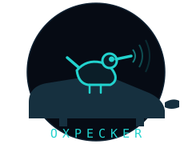
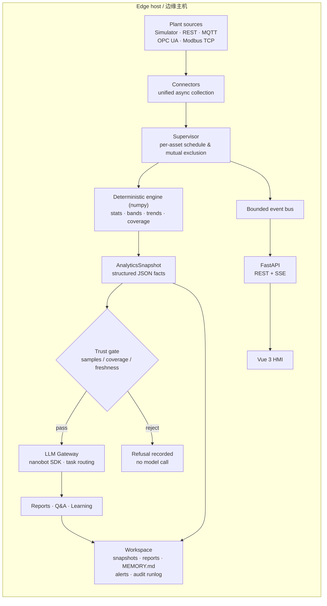

<div align="center">



# Oxpecker

**An open-source MVP: the shopfloor edge agent that watches your machines and explains what it sees.**

**Oxpecker（啄牛鸟）：一个开源 MVP —— 停在车间边缘、日夜守望设备、诚实报告的 Agent。**

[中文说明](docs/README.zh-CN.md) · [Architecture](#-architecture) · [Quick Start](#-quick-start) · [CLI](#-cli-reference) · [Deployment](#-deployment) · [Design notes](DESIGN.md)

</div>

> [!IMPORTANT]
> Oxpecker is an **advisory and observability system, not a safety controller**. Keep PLC interlocks, protective trips, and site safety procedures independent, and validate outputs with qualified personnel.
>
> Oxpecker 用于辅助分析与观测，**不是安全控制器**。请由专业人员验证结果，并保持 PLC 联锁、保护跳闸和现场安全规程独立有效。

## Why Oxpecker

Industrial telemetry fails in a specific way: the data is incomplete, stale, or
intermittent, and an LLM asked "how is this machine doing?" will happily invent
a confident answer anyway. Oxpecker exists to prevent exactly that.

**The oxpecker bird rides the rhino and warns it.** It doesn't steer the
rhino — it watches, and when danger approaches, it is the first to call out.
That is the contract this agent keeps with your equipment: honest observation,
honest alarm, never invention.

### What the agent actually does

Oxpecker runs a closed loop on an edge host, per monitored asset:

```
connect → collect → analyze (deterministic) → gate (trust decision) → interpret (LLM) → report / alert / learn
```

1. **Connect** — pull a collection window from the plant network through one of
   five built-in connectors: `simulator`, `REST`, `MQTT`, `OPC UA`, `Modbus TCP`.
2. **Analyze, deterministically** — a numpy engine turns the raw window into an
   `AnalyticsSnapshot`: statistics, band-exceedance runs, trends, coverage,
   sample counts, data freshness. **Every number in every report is computed
   by this code, never generated by a model.**
3. **Gate the data before trusting it** — the trust gate classifies each
   snapshot (nominal / degraded / unreliable), checking sample sufficiency,
   coverage ratio, data freshness, and consecutive empty windows. If the gate
   fails, Q&A and reports **explicitly refuse to guess** — the refusal reason
   (e.g. `n=5 < min_samples=10`) is recorded, and no model call is made.
4. **Interpret** — only for gate-passed snapshots, an LLM explains the facts:
   routine status lines, scheduled deep reports, and engineering Q&A. The
   snapshot, asset profile, and retrieved knowledge are injected as context —
   never the raw time series.
5. **Learn** — a scheduled daily pass distills "how this machine actually
   behaves" (observed limits, fault precursors, maintenance outcomes) into a
   per-asset `MEMORY.md` knowledge base, versioned with git. The longer it
   runs, the better it explains.
6. **Serve** — FastAPI REST + SSE with a browser HMI (overview, alerts, audit
   log, per-asset detail, configuration editor), plus a CLI for scripted
   operation and a demo mode that runs fully offline.

### Honest refusal is the feature

Most LLM-industrial demos answer every question. Oxpecker is built around the
opposite behavior:

| Data condition | Behavior |
|---|---|
| Enough samples, fresh, covered | Full analysis + interpretation |
| Low coverage, short window | Analysis only, trust flagged `degraded` |
| Stale data / consecutive empty windows | Gate **rejects**: Q&A refuses to answer, report marks unreliable, reason recorded |

This is what makes outputs auditable: when a report says "bearing temperature
drifted up 3°C over the window", that number traces back to the snapshot JSON,
and the trust level of the underlying data is stamped on the report.

### Performance and cost by design

Rather than quoting benchmark numbers that depend on your hardware and model
choice, Oxpecker's performance story is structural and verifiable in code:

- **Zero-token fact extraction.** The entire fact layer (statistics,
  exceedance, trends, coverage) runs in numpy with no model calls — the same
  window costs the same regardless of which LLM you pair with it.
- **Small context, not raw data.** Only the compressed snapshot JSON, the
  asset profile, and a capped slice of retrieved knowledge are injected
  (`history_max_chars` bounds it). A 7B-class local model can do routine work.
- **Task-based provider routing with automatic degradation.** Routine
  monitoring can run on a free local Ollama model; deep reports route to a
  stronger online model; if the network or API fails, the gateway falls back
  to the local model and stamps `degraded: true` on the output, so you always
  know which tier of model wrote a given report (compliance-friendly).
- **Runs on modest edge hardware.** Pure Python + numpy, no GPU required for
  the fact layer; bounded event bus and retention-capped snapshot storage are
  designed for fanless industrial PCs, not workstations.

## ✨ Features

- **5 connectors**: Simulator (drift + fault injection), REST pull, MQTT,
  OPC UA, Modbus TCP — unified async collection interface.
- **Deterministic fact layer**: per-window snapshots with statistics,
  threshold runs, trends, coverage, freshness.
- **Trust gates**: sample/coverage/freshness/empty-window checks with recorded
  refusal reasons; planned-downtime awareness.
- **AI orchestration via [nanobot](https://github.com/HKUDS/nanobot)**: task-level
  provider routing, timeout-wrapped degradation, structured failure handling.
- **Closed loop**: scheduled monitor/report/learn passes, operator feedback,
  alert ack with dedup, full audit runlog.
- **Git-versioned knowledge**: each asset's `MEMORY.md` is a revisable,
  auditable knowledge asset.
- **Browser HMI**: Vue 3 SPA served by FastAPI (REST + SSE), PIN-protectable,
  desktop and mobile layouts.
- **Two deployment shapes**: single-container Docker Compose, or bare-metal
  systemd (hardened unit included).
- **Offline demo mode**: seeded workspace + mock gateway, no model account
  needed to evaluate the product surface.
- **27 test files** covering pipeline, gates, trust, security, server, and
  end-to-end flow.

## 🚀 Quick Start

Requirements: Python 3.11+, and either a model account (online provider) or
[Ollama](https://ollama.com) with a local model. The simulator connector and
demo mode work without any model account for the deterministic parts.

### 1. Install

```bash
git clone https://github.com/happy-momo/oxpecker.git
cd oxpecker
python3 -m venv .venv && source .venv/bin/activate
pip install -e .
# Browser HMI frontend (optional but recommended):
cd hmi && npm install && npm run build && cd ..
```

### 2. Configure

```bash
cp config.sample.json config.json
$EDITOR config.json   # assets / metrics / sources / providers
```

Minimum viable config for the simulator:

```jsonc
{
  "workspace": "workspace",
  "hmi_pin": "your-pin",            // REQUIRED when the HMI is exposed beyond localhost
  "providers": {
    "online":  { "model_preset": "primary" },      // nanobot model preset name
    "offline": { "model_preset": "ollama-qwen" }
  },
  "assets": [
    {
      "asset_id": "pump1",
      "metrics": [
        { "name": "temperature", "unit": "°C", "warn_over": 80, "crit_over": 95 }
      ],
      "sources": [
        { "type": "simulator" }
      ]
    }
  ]
}
```

Model credentials live in `nanobot.runtime.json` (nanobot SDK config) — see
[nanobot providers docs](https://github.com/HKUDS/nanobot) for provider
presets (Anthropic, OpenAI-compatible endpoints, Ollama, vLLM, …).

### 3. Run

```bash
# One window end-to-end (collect → analyze → gate → interpret → archive):
oxpecker run config.json pump1

# Continuous supervisor loop + browser HMI on :8000:
oxpecker web config.json --host 0.0.0.0 --port 8000
```

Open `http://localhost:8000` — overview, alerts, audit log, per-asset charts,
and the configuration editor. Set `hmi_pin` before exposing it beyond
localhost.

### Try it offline in 60 seconds

```bash
oxpecker web config.demo.json --demo
```

Demo mode seeds a workspace and uses a mock gateway — no model account, no
plant network. Evaluate the full product surface, then swap in real config.

## 📖 CLI Reference

All commands take the config path as the first argument:

| Command | Purpose |
|---|---|
| `oxpecker setup config.json [--noop]` | Validate config, materialize per-asset `ASSET.md` profiles |
| `oxpecker run config.json <asset>` | One collect→analyze→gate→interpret→archive window |
| `oxpecker monitor config.json <asset>` | Routine status line (routes to the routine/local provider) |
| `oxpecker report config.json <asset>` | Deep report (routes to the strong/online provider) |
| `oxpecker learn config.json [asset]` | Learning pass: distill run history into per-asset `MEMORY.md` |
| `oxpecker ask config.json <asset> "question"` | Engineering Q&A against snapshot + knowledge base |
| `oxpecker feedback config.json <asset> "note"` | Record operator feedback into the learning loop |
| `oxpecker serve config.json` | Supervisor loop (no HMI) |
| `oxpecker web config.json [--demo]` | Supervisor + FastAPI HMI |

## 🏗 Architecture



- **Fact layer** (`oxpecker/analytics/`): numpy engine, fully deterministic.
- **Trust gates** (`oxpecker/analytics/gates.py`): classification, freshness,
  planned downtime.
- **AI orchestration** (`oxpecker/llm/`): nanobot SDK wrapping, context
  building with token/char budgets, provider routing + degradation.
- **Services** (`oxpecker/report/`, `oxpecker/qa/`, `oxpecker/learn/`):
  report generation & HTML export, Q&A engine, learning loop.
- **Server & HMI** (`oxpecker/server/`, `hmi/`): FastAPI REST/SSE + Vue 3 SPA.
- **Core** (`oxpecker/core/`): scheduler, asset store, memory service, audit
  runlog, credential vault, event bus.

[DESIGN.md](DESIGN.md) documents the "deterministic facts + LLM interpretation"
rationale, the dual-model degradation policy, and the learning loop in depth.

## ☁️ Deployment

**Docker Compose** (recommended for gateways/industrial PCs with a container
runtime):

```bash
cd deploy
cp ../config.sample.json config.json && $EDITOR config.json
docker compose up -d --build
```

**Bare-metal systemd** (older industrial PCs without Docker): see
[`deploy/README.md`](deploy/README.md) — a hardened unit
(`deploy/oxpecker.service`) is included, with the workspace on
`/var/lib/oxpecker`.

Either way, mount/persist the **workspace** directory — it holds snapshots,
reports, knowledge bases, alert state, and the audit runlog.

## 🧪 Development

```bash
pip install -e ".[dev]" 2>/dev/null || pip install pytest pytest-asyncio
pytest tests/ -v
```

The full suite runs without plant hardware: the simulator connector and the
mock gateway cover the deterministic pipeline, gates, server, and end-to-end
flow.

## 🗺 Roadmap

Oxpecker is an **idea-first MVP**: the architecture and trust-first contract
are complete, and the following are next:

- More plant protocols (Siemens S7, EtherNet/IP, MQTT Sparkplug B)
- Streaming/edge case coverage in the trust gate; per-metric gate policies
- Evaluation harness for interpretation quality against labeled windows
- Authentication model beyond the HMI PIN (per-user roles, audit identities)

Issues and PRs are welcome — see [CONTRIBUTING.md](CONTRIBUTING.md).

## 🤝 Contributing

Bug reports, reproduction cases, use cases, and suggestions: please open an
issue first. See [CONTRIBUTING.md](CONTRIBUTING.md) for the workflow.

## 📄 License

MIT — see [LICENSE](LICENSE).

Built on the [nanobot](https://github.com/HKUDS/nanobot) Python SDK for
model-provider abstraction and context injection. Oxpecker does not modify
nanobot's source.
