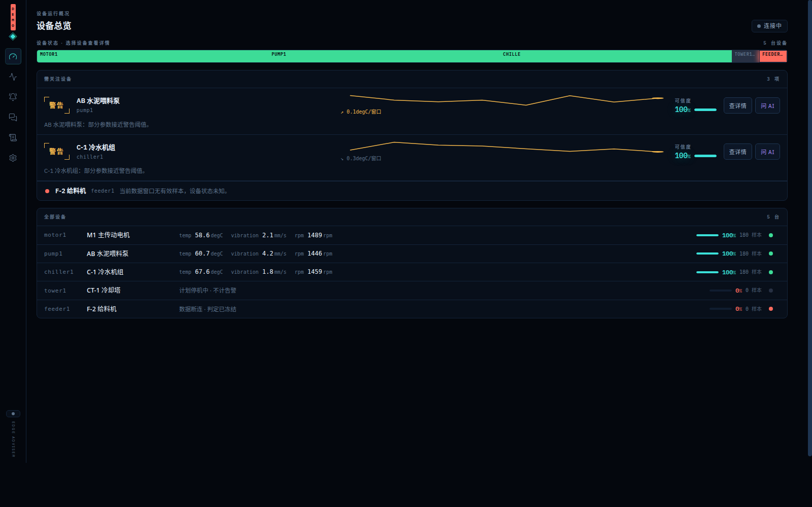
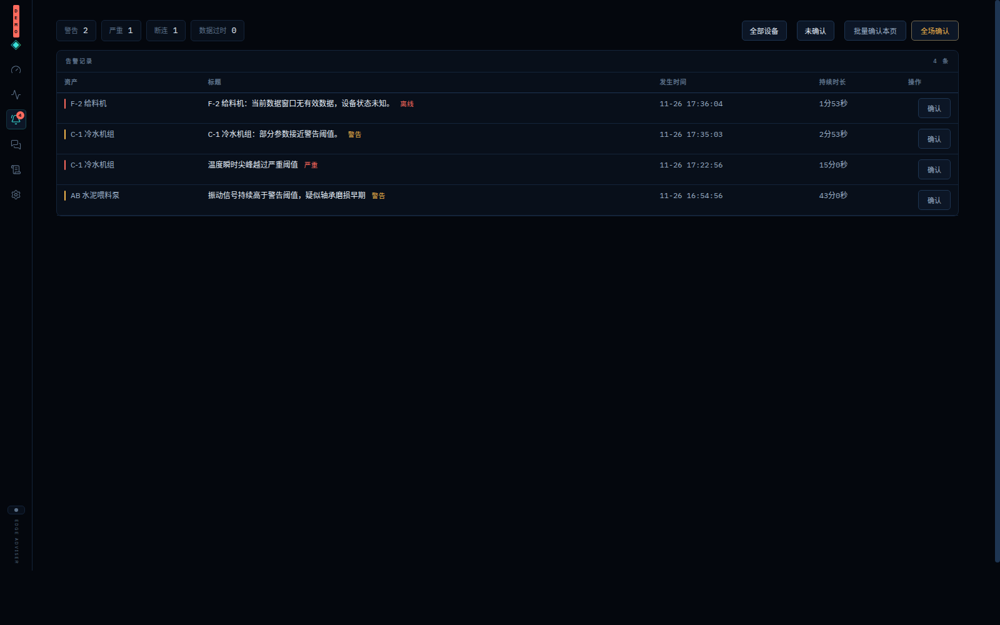
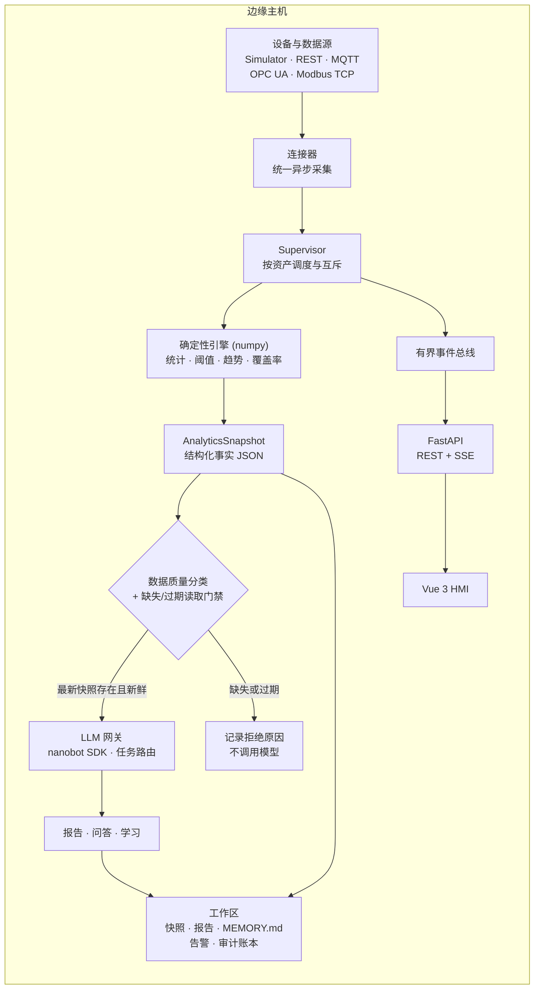
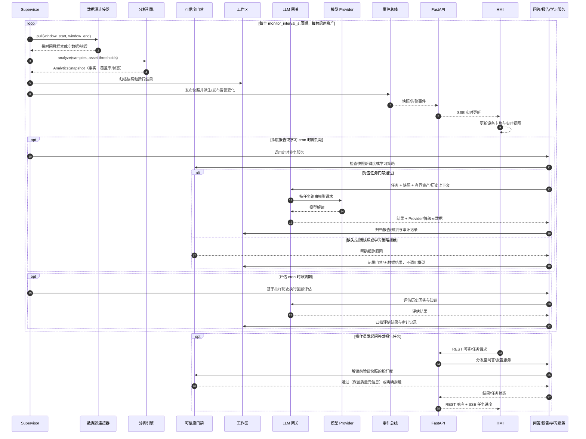

<div align="center">


# Oxpecker 中文说明

**停在你设备边缘、日夜守望、诚实报警的小鸟。**

[English](../README.md) · [架构](#技术架构) · [快速开始](#快速开始) · [系统截图](#系统截图) · [CLI](#cli-参考) · [部署](#部署) · [设计文档](../DESIGN.md)

</div>

> [!IMPORTANT]
> Oxpecker 用于辅助分析与观测，**不是安全控制器**。请由专业人员验证结果，并保持 PLC 联锁、保护跳闸和现场安全规程独立有效。

## 为什么叫 Oxpecker

牛椋鸟（oxpecker）停在犀牛、水牛背上：整日啄食皮毛里的寄生虫，危险靠近时
第一个尖叫报警。**它不操控宿主，而是呈现观测事实、标注数据质量并发出可检查的告警**
——这正是本 Agent 对设备扮演的角色。

工业数据有一种典型的失败方式：数据不完整、过期、时断时续，而如果你直接问
LLM"这台设备现在怎么样"，它可能会自信地给出并无数据支撑的答案。Oxpecker 通过
确定性计算测量事实、附带数据质量元信息，并明确标识缺失或过期数据，尽量降低这种风险。

## Agent 实际做什么

Oxpecker 在边缘主机上按资产运行一个闭环：

```
接入 → 采集 → 确定性分析 → 可信度门禁 → LLM 解读 → 报告 / 告警 / 学习
```

1. **接入** —— 通过 5 种内置连接器之一从厂内网络拉取采集窗口：
   `simulator`、`REST`、`MQTT`、`OPC UA`、`Modbus TCP`。
2. **确定性分析** —— numpy 引擎把原始窗口转化为结构化
   `AnalyticsSnapshot`：统计量、超限区间、趋势、覆盖率、样本数、数据新鲜度。
   **快照中的原始指标和数据范围元信息由代码计算，不由模型生成。**
   报告叙述由模型生成，仍须对照快照并由专业人员判断。
3. **先做数据质量分类，再做读取门禁** —— 确定性分析会在快照中记录样本充足性、
   覆盖率、新鲜度和连续空窗口状态。问答或报告解读前，读取门禁会在最新快照
   缺失或过期时拒绝调用模型。新鲜但被标记为 partial / insufficient 的快照不会
   被默默提升为健康状态；解读会携带其可信度和数据状态。学习闭环则通过单独的
   soft/strict 策略决定能否更新 `MEMORY.md`。
4. **解读** —— 只对通过门禁的快照，LLM 负责把事实讲清楚：例行状态、定时
   深度报告、工程问答。注入上下文的是快照、设备档案和检索到的知识，**永远
   不是原始时序**。
5. **学习** —— 每日定时任务把"这台设备实际怎么跑"（实际上下限、故障先兆、
   维护效果）蒸馏进该资产的 `MEMORY.md` 知识库，并通过 git 与操作员反馈进行修订。
6. **服务** —— FastAPI REST + SSE + 浏览器 HMI（总览、告警、审计、资产详情、
   配置编辑），外加 CLI 和完全离线的演示模式。

### 诚实拒绝是特性，不是缺陷

多数 LLM+工业的演示对每个问题都给出答案。Oxpecker 恰恰相反：

| 数据状况 | 行为 |
|---|---|
| 快照新鲜、样本和覆盖率充足 | 确定性分析 + 解读；解读带有快照数据范围元信息 |
| 快照新鲜，但覆盖率低或样本不足 | 质量状态与覆盖率会随上下文提供给模型；学习门禁按配置的 soft/strict 策略处理 |
| 没有快照或最新快照已过期 | 问答和深度报告读取门禁会在调用模型前**拒绝**并记录原因 |

连续空窗口会被分类为 insufficient/offline 并留下记录。它们不等同于缺失/过期
快照导致的读取门禁拒绝；操作员应先检查明确的状态与可信度元信息，再采取行动。
这就是可审计性的来源：快照 JSON 是测量事实的依据，报告中的数据范围元信息由
代码写入。请对照这些事实复核模型撰写的解释；生成的叙述本身不是经过验证的测量值。

### 设计层面的性能与成本

不引用依赖硬件与模型选择的跑分数字，Oxpecker 的性能故事是结构性的、可在
代码中验证的：

- **零 token 事实抽取。** 事实层（统计/超限/趋势/覆盖率）全部由 numpy 完成，
  不调用模型——同一窗口的成本与配什么 LLM 无关。
- **小上下文，而非原始数据。** 注入的只有压缩后的快照 JSON、设备档案和
  有上限的知识片段（`history_max_chars` 约束）。7B 级本地模型即可承担例行工作。
- **任务级 Provider 路由 + 自动降级。** 例行监控走免费的本地 Ollama；深度
  报告走更强的在线模型；网络/API 失败时网关自动回退本地模型，并在输出上盖
  `degraded: true` 章——你永远知道某份报告是哪一级模型写的（合规友好）。
- **跑得动普通边缘硬件。** 纯 Python + numpy，事实层无需 GPU；有界事件总线、
  按保留上限归档的快照存储，为无风扇工控机设计。

## 功能一览

- **5 种连接器**：Simulator（漂移+故障注入）、REST 拉取、MQTT、OPC UA、
  Modbus TCP —— 统一的异步采集接口。
- **确定性事实层**：按窗口生成快照，含统计量、阈值区间、趋势、覆盖率、新鲜度。
- **可信度分类与读取门禁**：对样本/覆盖率/新鲜度和空窗口进行状态分类；缺失或
  过期快照的读取拒绝会记录原因，并识别计划停机。
- **AI 编排（基于 [nanobot](https://github.com/HKUDS/nanobot)）**：任务级
  Provider 路由、超时包裹降级、结构化失败处理。
- **运行闭环**：周期采集、按 cron 生成深度报告和学习结果、可选回顾评估、操作员反馈、告警确认与审计账本。
- **git 版本化知识**：每个资产的 `MEMORY.md` 是可修订、可审计的知识资产。
- **浏览器 HMI**：FastAPI 承载的 Vue 3 单页应用（REST + SSE），可设 PIN 保护，
  桌面/移动布局。
- **两种部署形态**：单容器 Docker Compose，或裸机 systemd（含加固 unit）。
- **离线演示模式**：预置工作区 + 模拟网关，无需模型账号即可评估产品面。
- **离线测试覆盖**：涵盖管线、门禁、可信度、安全、服务端与端到端流程。

## 快速开始

环境要求：Python 3.11+；只有需要 LLM 解读时才需要在线模型账号或本地
[Ollama](https://ollama.com)。采集、确定性分析和离线演示不需要模型账号。
只有构建或开发 HMI 时才需要 Node.js/npm。

### 1. 安装

```bash
git clone https://github.com/happy-momo/Oxpecker-Your-shopfloor-Edge-Computing-Agent.git
cd Oxpecker-Your-shopfloor-Edge-Computing-Agent
python3 -m venv .venv && source .venv/bin/activate
pip install -e .
# 浏览器 HMI 前端（可选但推荐）：
cd hmi && npm ci && npm run build && cd ..
```

### 2. 配置

```bash
cp config.sample.json config.json
$EDITOR config.json   # assets / metrics / sources / providers / 信任阈值
oxpecker setup config.json
```

仓库自带的样例是完整的模拟器配置。单资产配置的结构如下（数据源在顶层，
通过资产 ID 关联）：

```jsonc
{
  "workspace": "workspace",
  "monitor_interval_s": 30,
  "data_freshness_s": 1800,
  "coverage_threshold": 0.8,
  "hmi_pin": "请替换为高强度 PIN",
  "assets": [
    {
      "asset_id": "pump1",
      "name": "给料泵",
      "kind": "pump",
      "window_s": 60,
      "metrics": [
        {
          "key": "temperature",
          "unit": "degC",
          "norm_max": 70,
          "warn_max": 75,
          "crit_max": 85,
          "persist": 5,
          "min_samples": 30
        }
      ]
    }
  ],
  "sources": [
    { "kind": "simulator", "asset_id": "pump1" }
  ]
}
```

以上仅展示配置结构。建议从 [`config.sample.json`](../config.sample.json)
复制并修改。`providers` 引用的模型预设必须存在于 `defaults.config_path`
指定的 nanobot 运行时配置文件（通常是 `nanobot.runtime.json`）中。不要把模型
凭据或部署 PIN 提交到版本库。支持的 Provider 见
[nanobot 文档](https://github.com/HKUDS/nanobot)。

### 3. 运行

```bash
# 单窗口采集、确定性分析并归档快照：
oxpecker run config.json pump1

# 常驻调度循环 + 浏览器 HMI（:8000）：
oxpecker web config.json --host 0.0.0.0 --port 8000
```

`oxpecker run` 采集一个窗口、完成分析并归档，不需要 LLM。`web` 命令启动周期
采集、cron 任务、API 和 HMI。浏览器打开 `http://localhost:8000` 可使用总览、
资产详情、告警、工程问答、审计和设置页面。生产模式需要先构建 SPA。服务对
网络开放前，必须配置非默认 `hmi_pin` 并在前置反向代理终止 TLS，详见
[部署章节](#部署)。

### 60 秒离线体验

```bash
oxpecker web config.demo.json --demo
```

演示模式预置工作区并使用模拟网关——不需要模型账号，也不需要厂内网络。
先评估完整产品面，再换入真实配置。

## 系统截图

以下截图来自预置的离线演示工作区。设备数值和告警均为模拟数据，仅用于展示
HMI 布局，不代表真实生产现场。

| 设备总览 | 告警中心 |
|---|---|
|  |  |

总览集中呈现设备状态、数据覆盖率、趋势与待处理事项；告警中心支持筛选和确认，
确认备注会作为操作员反馈保留。

## CLI 参考

所有命令的第一个参数都是配置文件路径：

| 命令 | 用途 |
|---|---|
| `oxpecker setup config.json [--noop]` | 校验配置，生成各资产 `ASSET.md` 档案 |
| `oxpecker run config.json <asset>` | 采集、分析并归档一个窗口的快照 |
| `oxpecker monitor config.json <asset>` | 例行状态（路由到例行/本地 Provider） |
| `oxpecker report config.json <asset>` | 深度报告（路由到强/在线 Provider） |
| `oxpecker learn config.json [asset]` | 学习：把运行历史蒸馏进 `MEMORY.md` |
| `oxpecker eval config.json [asset]` | 执行一次回顾评估 |
| `oxpecker ask config.json <asset> "问题"` | 基于快照 + 知识库的工程问答 |
| `oxpecker feedback config.json <asset> "备注"` | 把操作员反馈写入学习闭环 |
| `oxpecker serve config.json` | 调度循环（无 HMI） |
| `oxpecker web config.json [--demo]` | 调度 + FastAPI HMI |

## 技术架构



- **事实层**（`oxpecker/analytics/`）：numpy 引擎，完全确定性。
- **可信度门禁**（`oxpecker/analytics/gates.py`）：状态分级、新鲜度、计划停机。
- **AI 编排**（`oxpecker/llm/`）：nanobot SDK 封装、带预算的上下文构建、
  Provider 路由与降级。
- **业务服务**（`oxpecker/report/`、`oxpecker/qa/`、`oxpecker/learn/`）：
  报告生成与 HTML 导出、问答引擎、学习闭环。
- **服务端与 HMI**（`oxpecker/server/`、`hmi/`）：FastAPI REST/SSE + Vue 3 SPA。
- **核心**（`oxpecker/core/`）：调度器、资产仓库、记忆服务、审计账本、
  凭据保险库、事件总线。

[DESIGN.md](../DESIGN.md) 深入记录了"确定性事实 + LLM 解读"的理由、双模型
降级策略与学习闭环。

### 组件协同与数据流

系统采用单向事实链路：连接器返回样本，分析引擎生成快照，下游读取方才可解释
快照。模型不会生成或改写测量事实。调度器协调资产和 cron 任务；API 与 CLI
复用同一组业务服务。

| 组件 | 职责 | 主要目录 |
|---|---|---|
| 配置与资产注册表 | 校验资产、指标、数据源、Provider 和信任阈值 | `oxpecker/config/` |
| 数据接入连接器 | 将模拟器/REST/MQTT/OPC UA/Modbus 数据统一为带时间戳的样本 | `oxpecker/ingest/` |
| 分析引擎与可信度门禁 | 计算指标，并判定样本量、覆盖率、新鲜度和设备状态 | `oxpecker/analytics/` |
| Supervisor | 按资产串行化任务；采集窗口并触发定时作业 | `oxpecker/core/scheduler.py` |
| LLM 网关与上下文 | 按任务选择 Provider，限制上下文，并标记降级状态 | `oxpecker/llm/` |
| 业务服务 | 报告、问答、历史学习和知识回顾评估 | `oxpecker/report/`、`oxpecker/qa/`、`oxpecker/learn/`、`oxpecker/eval/` |
| 工作区与事件总线 | 保存快照、报告、反馈、告警和审计记录；分发实时事件 | `oxpecker/core/` |
| API 与 HMI | 提供 REST 操作、SSE 实时更新和操作员界面 | `oxpecker/server/`、`hmi/` |

每台资产的数据保存在配置的工作区中：

```text
workspace/
└── assets/<asset_id>/
    ├── ASSET.md                 # 生成的资产档案
    ├── MEMORY.md                # 可修订的设备学习知识
    ├── snapshots/<window>.json  # 确定性事实记录
    ├── reports/<date>/          # report.md + snapshot.json
    ├── runlog.jsonl             # 追加式任务/审计记录
    ├── alerts.jsonl             # 告警状态与确认
    └── feedback.jsonl           # 操作员反馈
```

### 任务执行时序

每个启用资产按 `monitor_interval_s` 周期采集。深度报告、学习和回顾评估仅在
各自配置的 cron 时隙触发。HMI 手动采集、报告和学习任务与调度器共享每资产
互斥锁，避免任务重叠；只读问答则使用最新快照新鲜度门禁。



状态分类与读取门禁判断都是确定性的。快照缺失或过期时，问答和深度报告会在
调用模型前停止并记录原因。其他新鲜但可信度低的快照仍保留其状态、覆盖率和
可信度信息；默认学习策略可以将低质量输入标注为低可信，而非当作已验证知识。
执行解读时，模型收到压缩快照及受限上下文，而不是原始时序数据。

## 部署

**Docker Compose**（有容器运行时的网关/工控机推荐）：

```bash
cd deploy
cp ../config.sample.json config.json
$EDITOR config.json  # 配置 hmi_pin、资产、数据源、Provider 和门禁阈值
# 如通过 HMI 管理连接器凭据，在部署环境/.env 注入 OXPECKER_CREDENTIAL_KEY；
# 不要提交该密钥。
docker compose up -d --build
curl -fsS http://localhost:8000/api/health
```

**裸机 systemd**（无 Docker 的老工控机）：见
[`deploy/README.md`](../deploy/README.md)，附加固过的
`deploy/oxpecker.service`，工作区落在 `/var/lib/oxpecker`。

Compose 将 `deploy/data` 挂载到容器 `/data`，并把 `OXPECKER_WORKSPACE` 指向该
卷。升级时应保留并备份**工作区**、配置和 Provider 凭据：工作区包含快照、报告、
知识、告警状态、反馈与审计记录。Oxpecker 本身提供 HTTP；非 localhost 访问时
应配置强 PIN、TLS 反向代理，并限制网络访问范围。完整的
[部署与联调指南](../deploy/README.md)包含健康检查、连接器联调、TLS/SSE 代理、
升级和恢复步骤。

## 开发

```bash
python3.11 -m venv .venv && source .venv/bin/activate
pip install -e .
pip install pytest pytest-asyncio
pytest -q

cd hmi
npm ci
npm run typecheck
npm test
npm run build
```

全套测试无需现场硬件：模拟器连接器和模拟网关覆盖确定性管线、门禁、
服务端与端到端流程。HMI 开发服务器会把 API 和 SSE 请求代理到 8000 端口的后端：

```bash
# 终端 1（仓库根目录）
oxpecker web config.demo.json --demo --host 127.0.0.1 --port 8000

# 终端 2
cd hmi && npm run dev
# 浏览器打开 http://localhost:5173/dist/
```

### 二次开发扩展点

- **新增数据连接器：** 在 `oxpecker/ingest/` 实现
  `DataSource.pull(window_start, window_end)` 和 `aclose()`，在工厂中注册，
  并使用假数据或本地数据增加确定性测试。
- **新增或调整分析：** 在 `oxpecker/analytics/` 计算事实并写入
  `AnalyticsSnapshot`；不要让 LLM 计算测量值。
- **新增解读任务：** 复用问答/报告/学习服务并通过 `LLMGateway` 路由；
  任何 Provider 调用前检查最新快照门禁，并保留 Provider/降级元数据。
- **调整 API 或界面：** 在 `oxpecker/server/` 增加有类型约束的 FastAPI 路由，
  并通过 `hmi/src/api/` 和 runtime store 调用；实时任务和遥测使用 SSE，而非轮询。
- **保持可审计性：** 拒绝和失败都记录原因；通过模拟器与 mock gateway 覆盖行为。
  详见 [`CONTRIBUTING.md`](../CONTRIBUTING.md) 的架构约束。

## 路线图

Oxpecker 是一个**理念先行的 MVP**：架构与"信任先行"契约已完成，接下来：

- 更多现场协议（Siemens S7、EtherNet/IP、MQTT Sparkplug B）
- 门禁的流式/边界场景覆盖；按指标的门禁策略
- 扩大评估数据集并持续跟踪解读质量
- HMI PIN 之外的认证模型（按用户角色、审计身份）

欢迎提交 issue 与 PR，见 [CONTRIBUTING.md](../CONTRIBUTING.md)。

## 许可

MIT —— 见 [LICENSE](../LICENSE)。

基于 [nanobot](https://github.com/HKUDS/nanobot) Python SDK 构建模型 Provider
抽象与上下文注入。Oxpecker 不修改 nanobot 源码。
