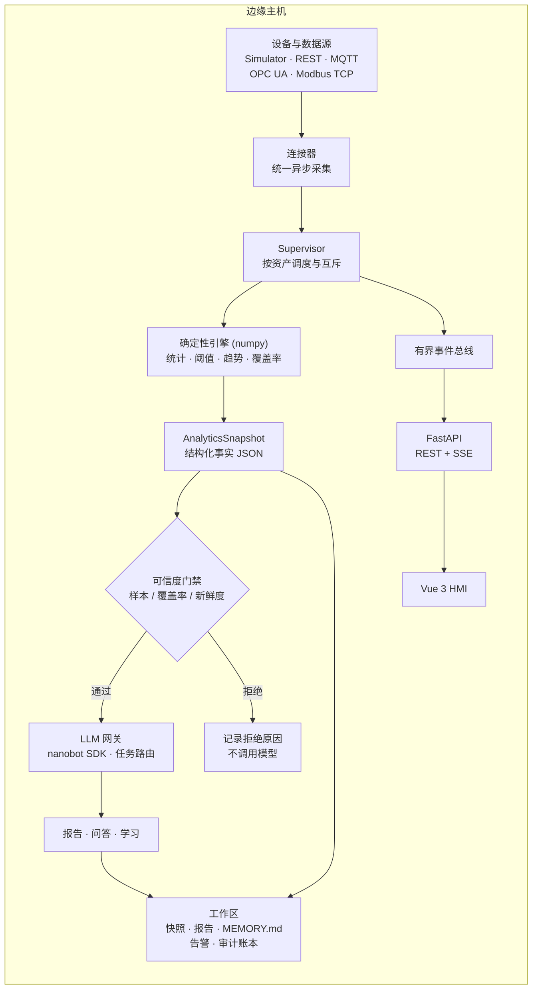

<div align="center">


# Oxpecker 中文说明

**停在你设备边缘、日夜守望、诚实报警的小鸟。**

[English](../README.md) · [架构](#技术架构) · [快速开始](#快速开始) · [CLI](#cli-参考) · [部署](#部署) · [设计文档](../DESIGN.md)

</div>

> [!IMPORTANT]
> Oxpecker 用于辅助分析与观测，**不是安全控制器**。请由专业人员验证结果，并保持 PLC 联锁、保护跳闸和现场安全规程独立有效。

## 为什么叫 Oxpecker

牛椋鸟（oxpecker）停在犀牛、水牛背上：整日啄食皮毛里的寄生虫，危险靠近时
第一个尖叫报警。**它不操控宿主，只诚实观察、诚实报警**——这正是本 Agent
对设备扮演的角色。

工业数据有一种典型的失败方式：数据不完整、过期、时断时续，而如果你直接问
LLM"这台设备现在怎么样"，它会毫不犹豫地编一个自信的答案。Oxpecker 就是为
了防止这一点而生的。

## Agent 实际做什么

Oxpecker 在边缘主机上按资产运行一个闭环：

```
接入 → 采集 → 确定性分析 → 可信度门禁 → LLM 解读 → 报告 / 告警 / 学习
```

1. **接入** —— 通过 5 种内置连接器之一从厂内网络拉取采集窗口：
   `simulator`、`REST`、`MQTT`、`OPC UA`、`Modbus TCP`。
2. **确定性分析** —— numpy 引擎把原始窗口转化为结构化
   `AnalyticsSnapshot`：统计量、超限区间、趋势、覆盖率、样本数、数据新鲜度。
   **报告里的每个数字都由这段代码算出，绝不是模型生成的。**
3. **先过可信度门禁** —— 门禁对每个快照分级（nominal / degraded /
   unreliable），检查样本充足性、覆盖率、数据新鲜度、连续空窗口。门禁不通过
   时，问答和报告**明确拒绝猜测**——拒绝原因（如 `n=5 < min_samples=10`）
   被记录在案，且不调用模型。
4. **解读** —— 只对通过门禁的快照，LLM 负责把事实讲清楚：例行状态、定时
   深度报告、工程问答。注入上下文的是快照、设备档案和检索到的知识，**永远
   不是原始时序**。
5. **学习** —— 每日定时任务把"这台设备实际怎么跑"（实际上下限、故障先兆、
   维护效果）蒸馏进该资产的 `MEMORY.md` 知识库，git 版本化。运行越久，解释
   越准。
6. **服务** —— FastAPI REST + SSE + 浏览器 HMI（总览、告警、审计、资产详情、
   配置编辑），外加 CLI 和完全离线的演示模式。

### 诚实拒绝是特性，不是缺陷

多数 LLM+工业的演示对每个问题都给出答案。Oxpecker 恰恰相反：

| 数据状况 | 行为 |
|---|---|
| 样本充足、新鲜、覆盖完整 | 完整分析 + 解读 |
| 低覆盖率 / 窗口过短 | 仅分析，可信度标记 `degraded` |
| 数据过期 / 连续空窗口 | 门禁**拒绝**：问答拒答、报告标记不可信、原因入账 |

这就是可审计性的来源：报告说"轴承温度窗口内上升 3°C"，这个数字可以追溯回
快照 JSON，且底层数据的可信等级就印在报告上。

### 设计层面的性能与成本

不引用依赖硬件与模型选择的跑分数字，Oxpecker 的性能故事是结构性的、可在
代码中验证的：

- **零 token 事实抽取。** 事实层（统计/超限/趋势/覆盖率）全部由 numpy 完成，
  不调用模型——同一窗口的成本与配什么 LLM 无关。
- **小上下文，而非原始数据。** 注入的只有压缩后的快照 JSON、设备档案和
  有上限的知识片段（`history_max_chars` 约束）。7B 级本地模型即可承担例行工作。
- **任务级 Provider 路由 + 自动降级。** 例行监控走免费的本地 Ollama；深度
  报告走更强的在线模型；网络/API 失败时网关自动回退本地模型，并在输出上盖
  `degraded: true` 章——你永远知道某份报告是哪一级模型写的（合规友好）。
- **跑得动普通边缘硬件。** 纯 Python + numpy，事实层无需 GPU；有界事件总线、
  按保留上限归档的快照存储，为无风扇工控机设计。

## 功能一览

- **5 种连接器**：Simulator（漂移+故障注入）、REST 拉取、MQTT、OPC UA、
  Modbus TCP —— 统一的异步采集接口。
- **确定性事实层**：按窗口生成快照，含统计量、阈值区间、趋势、覆盖率、新鲜度。
- **可信度门禁**：样本/覆盖率/新鲜度/空窗口检查，拒绝原因入账；感知计划停机。
- **AI 编排（基于 [nanobot](https://github.com/HKUDS/nanobot)）**：任务级
  Provider 路由、超时包裹降级、结构化失败处理。
- **运行闭环**：定时监控/报告/学习、操作员反馈、告警确认去重、完整审计账本。
- **git 版本化知识**：每个资产的 `MEMORY.md` 是可修订、可审计的知识资产。
- **浏览器 HMI**：FastAPI 承载的 Vue 3 单页应用（REST + SSE），可设 PIN 保护，
  桌面/移动布局。
- **两种部署形态**：单容器 Docker Compose，或裸机 systemd（含加固 unit）。
- **离线演示模式**：预置工作区 + 模拟网关，无需模型账号即可评估产品面。
- **27 个测试文件**：覆盖管线、门禁、可信度、安全、服务端与端到端流程。

## 快速开始

环境要求：Python 3.11+，以及在线模型账号或本地
[Ollama](https://ollama.com)。模拟器连接器和演示模式的确定性部分不需要任何
模型账号。

### 1. 安装

```bash
git clone https://github.com/happy-momo/oxpecker.git
cd oxpecker
python3 -m venv .venv && source .venv/bin/activate
pip install -e .
# 浏览器 HMI 前端（可选但推荐）：
cd hmi && npm install && npm run build && cd ..
```

### 2. 配置

```bash
cp config.sample.json config.json
$EDITOR config.json   # assets / metrics / sources / providers
```

模拟器的最小可用配置：

```jsonc
{
  "workspace": "workspace",
  "hmi_pin": "your-pin",            // HMI 暴露到 localhost 之外时必填
  "providers": {
    "online":  { "model_preset": "primary" },      // nanobot 模型预设名
    "offline": { "model_preset": "ollama-qwen" }
  },
  "assets": [
    {
      "asset_id": "pump1",
      "metrics": [
        { "name": "temperature", "unit": "°C", "warn_over": 80, "crit_over": 95 }
      ],
      "sources": [
        { "type": "simulator" }
      ]
    }
  ]
}
```

模型凭据放在 `nanobot.runtime.json`（nanobot SDK 配置）——Provider 预设
（Anthropic、OpenAI 兼容端点、Ollama、vLLM 等）见
[nanobot 文档](https://github.com/HKUDS/nanobot)。

### 3. 运行

```bash
# 单窗口端到端（采集 → 分析 → 门禁 → 解读 → 归档）：
oxpecker run config.json pump1

# 常驻调度循环 + 浏览器 HMI（:8000）：
oxpecker web config.json --host 0.0.0.0 --port 8000
```

打开 `http://localhost:8000` —— 总览、告警、审计、资产图表与配置编辑器。
暴露到 localhost 之外前务必设置 `hmi_pin`。

### 60 秒离线体验

```bash
oxpecker web config.demo.json --demo
```

演示模式预置工作区并使用模拟网关——不需要模型账号，也不需要厂内网络。
先评估完整产品面，再换入真实配置。

## CLI 参考

所有命令的第一个参数都是配置文件路径：

| 命令 | 用途 |
|---|---|
| `oxpecker setup config.json [--noop]` | 校验配置，生成各资产 `ASSET.md` 档案 |
| `oxpecker run config.json <asset>` | 单窗口：采集→分析→门禁→解读→归档 |
| `oxpecker monitor config.json <asset>` | 例行状态（路由到例行/本地 Provider） |
| `oxpecker report config.json <asset>` | 深度报告（路由到强/在线 Provider） |
| `oxpecker learn config.json [asset]` | 学习：把运行历史蒸馏进 `MEMORY.md` |
| `oxpecker ask config.json <asset> "问题"` | 基于快照 + 知识库的工程问答 |
| `oxpecker feedback config.json <asset> "备注"` | 把操作员反馈写入学习闭环 |
| `oxpecker serve config.json` | 调度循环（无 HMI） |
| `oxpecker web config.json [--demo]` | 调度 + FastAPI HMI |

## 技术架构



- **事实层**（`oxpecker/analytics/`）：numpy 引擎，完全确定性。
- **可信度门禁**（`oxpecker/analytics/gates.py`）：状态分级、新鲜度、计划停机。
- **AI 编排**（`oxpecker/llm/`）：nanobot SDK 封装、带预算的上下文构建、
  Provider 路由与降级。
- **业务服务**（`oxpecker/report/`、`oxpecker/qa/`、`oxpecker/learn/`）：
  报告生成与 HTML 导出、问答引擎、学习闭环。
- **服务端与 HMI**（`oxpecker/server/`、`hmi/`）：FastAPI REST/SSE + Vue 3 SPA。
- **核心**（`oxpecker/core/`）：调度器、资产仓库、记忆服务、审计账本、
  凭据保险库、事件总线。

[DESIGN.md](../DESIGN.md) 深入记录了"确定性事实 + LLM 解读"的理由、双模型
降级策略与学习闭环。

## 部署

**Docker Compose**（有容器运行时的网关/工控机推荐）：

```bash
cd deploy
cp ../config.sample.json config.json && $EDITOR config.json
docker compose up -d --build
```

**裸机 systemd**（无 Docker 的老工控机）：见
[`deploy/README.md`](../deploy/README.md)，附加固过的
`deploy/oxpecker.service`，工作区落在 `/var/lib/oxpecker`。

两种形态都要持久化**工作区**目录——快照、报告、知识库、告警状态和审计
账本都在里面。

## 开发

```bash
pip install -e ".[dev]" 2>/dev/null || pip install pytest pytest-asyncio
pytest tests/ -v
```

全套测试无需现场硬件：模拟器连接器和模拟网关覆盖确定性管线、门禁、
服务端与端到端流程。

## 路线图

Oxpecker 是一个**理念先行的 MVP**：架构与"信任先行"契约已完成，接下来：

- 更多现场协议（Siemens S7、EtherNet/IP、MQTT Sparkplug B）
- 门禁的流式/边界场景覆盖；按指标的门禁策略
- 面向标注窗口的解读质量评估工具
- HMI PIN 之外的认证模型（按用户角色、审计身份）

欢迎提交 issue 与 PR，见 [CONTRIBUTING.md](../CONTRIBUTING.md)。

## 许可

MIT —— 见 [LICENSE](../LICENSE)。

基于 [nanobot](https://github.com/HKUDS/nanobot) Python SDK 构建模型 Provider
抽象与上下文注入。Oxpecker 不修改 nanobot 源码。
